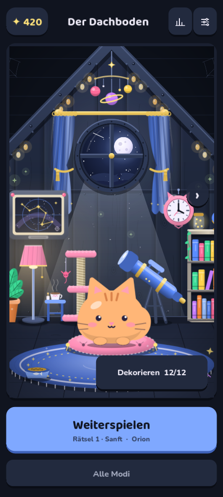

# Miso Sudoku

A calm Sudoku game with Miso the cat. No ads, no accounts, no tracking.

- Star path: hundreds of puzzles from gentle to expert, each one lights up a star of a constellation
- Daily puzzle, mini Sudokus (4×4, 6×6), variants (Sudoku X, Windoku, Jigsaw, Miso's Paws)
- Decorate Miso's rooms with the stardust you earn
- German and English

## Install

**With [Obtainium](https://github.com/ImranR98/Obtainium) (gets updates automatically):** add an app, paste `https://github.com/SlayerTO/miso-sudoku`.

**By hand:** download the APK from the [latest release](https://github.com/SlayerTO/miso-sudoku/releases/latest) and open it on your Android phone.

The game also shows a small note on its home screen when a new version is out.

## Privacy

The app collects nothing. Once a day it asks GitHub whether a newer version exists; GitHub sees your IP address like any website. Your progress stays on your phone (Settings → copy save, to move it to another phone).

---

Ein ruhiges Sudoku mit Miso der Katze. Keine Werbung, kein Konto, kein Tracking. Installation per Obtainium (Link oben einfügen) oder APK aus dem neuesten Release.
